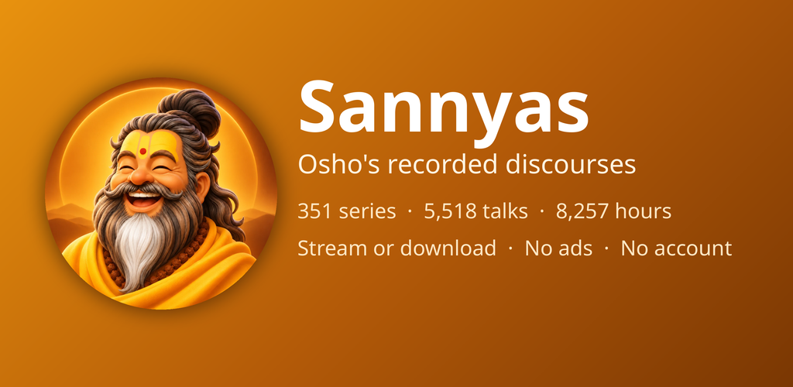
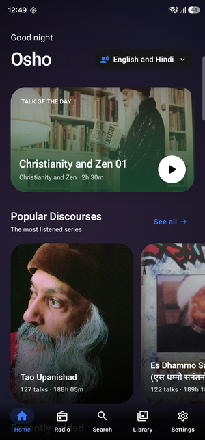
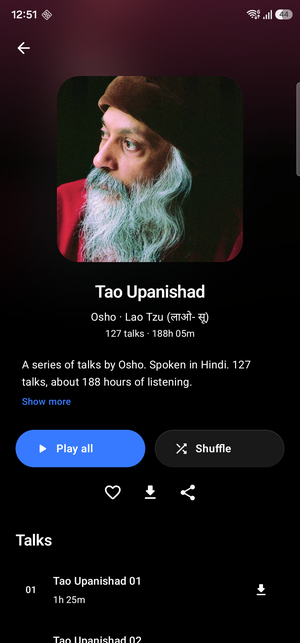
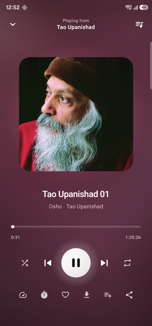
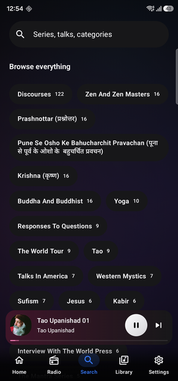

<div align="center">



# Sannyas

**No account. No ads. No tracking. Just listening — in English and हिन्दी.**

<br>

[](https://github.com/rishabh3354/sannyas/releases/latest)


[](https://github.com/rishabh3354/sannyas/releases)

<br>

<table>
  <tr>
    <td></td>
    <td></td>
    <td></td>
    <td></td>
  </tr>
  <tr align="center">
    <td><sub>Home</sub></td>
    <td><sub>Series</sub></td>
    <td><sub>Player</sub></td>
    <td><sub>Browse</sub></td>
  </tr>
</table>

</div>

---

## Install

Grab **`sannyas-1.0.0.apk`** from the [latest release](https://github.com/rishabh3354/sannyas/releases/latest) and open it on your phone.

Android will ask you to allow installs from whichever app you opened it with — that's the normal one-time prompt for installing outside the Play Store.

> **Requires Android 7.0 or newer.**

<details>
<summary>Verifying your download</summary>

<br>

```
APK SHA-256           a4e3af7520cd5f26093f6c699423a44daee697fedcc08e2cdca1c556291a5b49
Signing cert SHA-256  0a114fd24efaa6bf8fccf98dcff92e50dcd23b350e91db76c767901e49633578
```

```bash
sha256sum sannyas-1.0.0.apk
apksigner verify --print-certs sannyas-1.0.0.apk
```

The certificate hash is the more useful of the two — it proves a build came from
the original signing key.

</details>

---

## What it does

### Listening

- **Background playback** that keeps going with the screen off, with lock-screen and notification controls
- **Bluetooth, wired headsets and media buttons** all handled, including pause when you unplug
- **Android Auto and Assistant** — browse the whole catalogue by voice or on the car screen
- **Picks up where you left off**, per talk, surviving restarts

### Offline

- **Download any talk or whole series** for listening without a connection
- Downloads continue in the background and survive a reboot
- Downloaded audio is kept separate from the streaming cache, so clearing one never touches the other

### Controls that matter for long talks

Most of these run over an hour, so:

- **Sleep timer** — a fixed duration, or "until the end of this talk"
- **Playback speed**
- **Skip silence**
- **Shuffle, repeat, and a queue you can reorder**

### Finding things

- **Search** across series, talks and categories
- **Browse by category** — Zen, Buddha, Krishna, Sufism, Tao, Kabir, Yoga and 48 more
- **Radio** for when you'd rather not choose
- **Favourites, playlists, bookmarks** and listening history
- **Switch between English and Hindi** discourses at any time

### Look and feel

- Dark and light themes, with **Material You** dynamic colour
- Artwork-derived colours on the player screen
- Built for screen readers throughout — proper touch targets, sensible TalkBack descriptions, and type that scales with your system font size

---

## Privacy

**Nothing is collected.** There is no server, no account, and no analytics or advertising code of any kind.

Favourites, history and settings live on your device and are gone when you uninstall. The only network requests the app makes are for the audio and artwork themselves, streamed on demand from [oshoworld.com](https://oshoworld.com) — so that site sees your IP address, the same way visiting any website would.

📄 **[Full privacy policy](https://rishabh3354.github.io/sannyas/privacy-policy.html)**

---

## Under the hood

| | |
| --- | --- |
| **Language** | Kotlin 2.0 |
| **UI** | Jetpack Compose + Material 3 — no XML layouts |
| **Playback** | Media3 / ExoPlayer behind a `MediaLibraryService` |
| **Storage** | Room for your data, DataStore for settings |
| **DI** | Hilt |
| **Architecture** | MVVM over Clean Architecture layers |

`minSdk 24` · `targetSdk 36` · AGP 8.13 · single module

The catalogue ships inside the app as a single JSON asset, so there's no backend to run and nothing to sign up for. Audio is streamed directly from the source rather than rehosted.

```bash
./gradlew assembleDebug      # debug build
./gradlew bundleRelease      # signed AAB, needs RELEASE_* in local.properties
```

📐 **[Architecture notes](docs/ARCHITECTURE.md)** — how playback state is owned, why the catalogue never touches the database, the caching split, and how to regenerate the catalogue.

---

## A note on what this is

Sannyas is an independent player. It is **not affiliated with, endorsed by, or connected to** OshoWorld or Osho International Foundation.

Audio is streamed directly from the source rather than rehosted, and no discourse text is redistributed. "Sannyas" is a generic Sanskrit term, chosen deliberately so the product name carries no third-party mark. References to Osho here and in the app are descriptive — they identify whose discourses these are — not a claim of affiliation.

<div align="center">
<br>
<sub>Built by <a href="https://warlordsoftwares.com">Rishabh Bhardwaj</a></sub>
</div>
